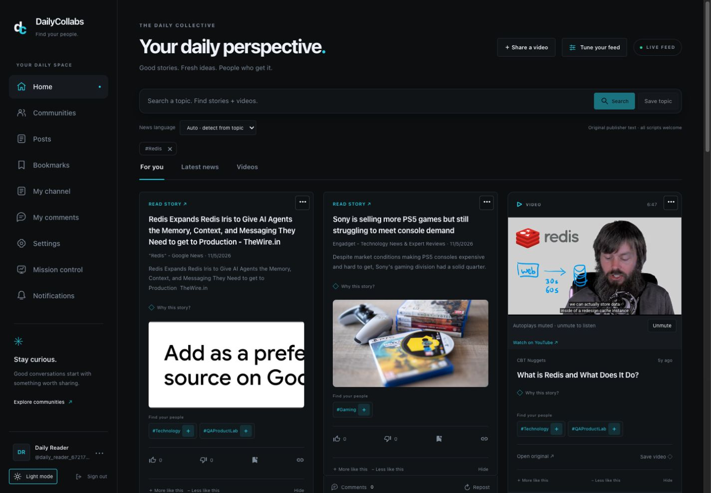

# DailyCollabs

A personal news, video and community space. Search an interest, discover relevant stories and YouTube videos, and carry the conversation into a community or your own channel.



## What you can do

- **Discover your interests:** topic search returns related news and real YouTube results with an animated pixel search indicator. The search prompt stays pinned as you scroll, so another topic is always in reach. Publisher images are preferred; relevant Wikimedia artwork includes attribution. Missing or broken images receive stable, topic-aware artwork unique to each card; shared topic covers use distinct card framing.
- **One mixed For you feed:** articles and real videos are interleaved from your interests and recent searches. A topic search or saved-topic click opens **Latest news** in date order; **Videos** retains the same topic. Returning to **For you** refreshes an independent mix, with at most three items from the latest researched topic in a default twelve-item page when matching results are available.
- **Watch in your feed:** videos in **For you** display their player and start muted, with an explicit unmute control. Unmuting one player mutes the others. Playback pauses outside the viewport; browser/provider policies may still require a play gesture. Other views keep their deliberate watch flow.
- **Read in your language:** automatic script detection, common language editions and custom BCP 47 language tags, including Hebrew sources and right-to-left cards. Articles remain in their source language; availability depends on publishers and news editions.
- **Shape your feed:** Balanced, Latest, Discover and Following modes; personalization on/off; freshness and source-diversity controls; followed/muted topics; visible interest sources; More/Less/Hide feedback and history reset. Explicit topic and language searches remain constrained to that request.
- **Build a community:** create a board, join one, invite members, use channels, manage rules and require acceptance of updated rules. Owners manage channels; announcement channels can be read-only. Five demo communities are seeded without replacing existing boards.
- **Take a story somewhere:** fitting community hashtags and inline join, explicit repost, and long-press/drag targets for community, personal channel and sharing. Keyboard-accessible action menus offer the same operations. Email, WhatsApp and native sharing are supported; Instagram uses copy-link plus an explicit app/site handoff.
- **Join the discussion:** persistent story/video comments, replies, likes/dislikes, custom emoji expressions, editing and deletion of your own comments. **My comments** keeps your contributions together. **Notifications** records other users liking, disliking, replying to or reposting your comments, with unread and mark-read controls.
- **Keep your collection:** account-scoped bookmarks for articles, videos and posts; searchable saved views; a post composer; and a persistent personal repost channel.
- **Make it yours:** a compact light/dark switch in navigation saves your theme to your account. Profile settings also offer name, username, avatar, theme and motion preferences. The responsive interface uses compact corners, restrained animation and accessible focus states.
- **See the work:** Mission control shows four agent missions, progress, activity and availability, alongside source/build/test and service-health checks.

The welcome page uses a capture of the actual app and an animated laptop film made with that capture. It includes playback controls and respects reduced motion.

## Run locally

Prerequisites: Node.js **20.19+ or 22.12+**, Python **3.10+**, and MongoDB 7 (local, Docker or a configured remote database).

From the repository root:

```bash
# Start a new local database only if you do not already have one running.
docker run -d --name dailycollabs-mongo -p 127.0.0.1:27017:27017 mongo:7

npm --prefix Backend ci
npm --prefix Frontend/client ci
python3 -m venv ai_service/.venv
ai_service/.venv/bin/pip install -r ai_service/requirements.txt

cp Backend/.env.example Backend/.env
cp ai_service/.env.example ai_service/.env
# Set a unique JWT_SECRET in Backend/.env. Add an AI provider key if desired.
node scripts/dev.cjs
```

Open [the app](http://localhost:5173), register and sign in. The public welcome page is also available at [/Welcome](http://localhost:5173/Welcome), and the progress dashboard at [/Agents](http://localhost:5173/Agents).

The launcher starts the API on **4000**, frontend on **5173**, AI service on **5000**, and the quality watcher. The AI service has a deterministic fallback when no provider key is configured; topic news search remains available through RSS/news editions. YouTube search uses an optional official API key or best-effort public search. If a provider is unavailable, the app shows its status instead of substituting unrelated videos.

To use existing services or alternate ports:

```bash
START_AI=false AI_SERVICE_URL=http://127.0.0.1:5000 node scripts/dev.cjs
DEV_API_PORT=4001 DEV_WEB_PORT=5174 DEV_AI_PORT=5001 node scripts/dev.cjs
```

## Configuration

| File | Settings |
| --- | --- |
| `Backend/.env` | `MONGO_URI`, `JWT_SECRET`, `PORT`, `AI_SERVICE_URL`, `FRONTEND_URL`; optional `YOUTUBE_API_KEY` |
| `Frontend/client/.env` | `VITE_API_URL` (defaults to localhost:4000; launcher sets its chosen API port) |
| `ai_service/.env` | `AI_PROVIDER`, `AI_MODEL`, provider key and optional compatible base URL |

Environment files, local accounts and credentials are excluded from commits. Legacy topics without an account owner remain stored but are not displayed or silently assigned to a user; save your own topics again. See [DEPLOY.md](DEPLOY.md) for separate-service deployment.

## Architecture

| Area | Stack / responsibility |
| --- | --- |
| `Frontend/client` | React 19, React Router, Vite 7, CSS; media, communities, comments, collection and preference UI |
| `Backend` | Express 5, Mongoose, JWT; account permissions, community channels, content actions, notifications, search and feed ranking |
| `ai_service` | FastAPI; optional cloud model for feed discovery, locale-aware fallback |
| MongoDB | Users, communities/channels/messages, posts, bookmarks, comments/reactions, notifications, feed preferences and expiring activity |
| `scripts` | Development launcher, quality watcher, agent progress updates and product-film renderer |

The feed uses an **explainable weighted baseline** with an interleaved discovery stream. For you is independent of the active topic result pages; recent research contributes a limited portion instead of replacing the whole feed. It is not a trained deep-learning recommendation model. It learns from the signed-in user's selected topics, saved items, joined communities and bounded recent search/open/feedback signals. Explicit choices carry more weight than incidental opens. Recent signals expire after 90 days; reset clears learned activity while retaining bookmarks, saved topics, follows and memberships. Ranking snapshots keep pagination stable and are scoped to the account, query and locale. This work does not establish a measured retention or satisfaction improvement.

## Validation

```bash
npm --prefix Frontend/client run build
npm --prefix Backend test
```

The behavioral suite covers account isolation, profile validation, community ownership and rules, channels and emoji reactions, persistent collections, topic video parsing, images/locales, card actions, ranking and comment/notification events. Tests create bounded fixtures and clean up their own records. Optional live-provider checks depend on network access and may be skipped by default.

The quality watcher rebuilds and reruns backend behavior checks when source changes, then refreshes service health every 15 seconds. It reports failures in Mission control. **Coding agents investigate and edit during an active coding session; the watcher does not independently launch an AI agent or silently modify code.**

## Research and media

- [89-site recommendation, interface and community research ledger](research/algorithm/README.md), including per-source takeaways and implementation decisions.
- [Initial design research](research/agent-1.md), [community research](research/agent-2.md), [settings research](research/agent-3.md), and [media research](research/agent-4.md).
- [Actual-app laptop film](Frontend/client/public/welcome/laptop-demo.mp4). Re-render with `python3 scripts/render-product-film.py --screen-capture Frontend/client/public/welcome/app-preview.jpg` after installing the script's documented media dependencies.

Publisher content and linked videos remain the property of their respective owners. Wikimedia fallback images link to their source/credit page. Demo material and community counts are labeled as such; the app does not claim external publisher endorsement or news certification.
